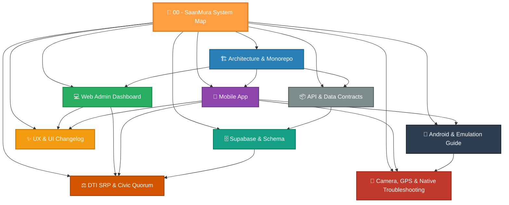

# 🛒 SaanMura — Civic Price Transparency & DTI Quorum Network

> **SaanMura** is an open civic-tech platform empowering Filipino consumers and palengke scouts to monitor, report, and verify basic necessity and prime commodity prices against **DTI Suggested Retail Price (SRP)** baselines using crowdsourced observations, receipt OCR, and a multi-verifier quorum consensus protocol.

---

## 🗺️ Codebase Map of Content (MOC)

### 1. Core Engineering & Infrastructure
- [[Architecture & Monorepo Structure]] — Monorepo workspace organization, PNPM packages, build pipelines, and dependencies.
- [[API & Data Contracts]] — Shared type definitions (`@saanmura/shared-types`), Zod schemas (`@saanmura/validation`), and domain logic (`@saanmura/domain`).
- [[Supabase & Database Schema]] — PostgreSQL tables, relations, RLS security policies, and edge consensus triggers.

### 2. Client Applications
- [[Web Admin Dashboard]] — React 18, Vite, and Tailwind CSS control center for LGU verifiers, DTI compliance auditors, and retail registry managers.
- [[Mobile App]] — React Native Expo Router application for community Palengke Scouts, real-time barcode scanning, and receipt/shelf tag evidence logging.

### 3. Verification & Governance
- [[DTI SRP & Civic Quorum Protocol]] — Dual-verifier threshold rules ($\ge 2$ independent signatures), PhilSys trust weighting, and variance calculations.

### 4. Implementation Evolution & Operations
- [[UX & UI Changelog]] — Documented log of recent UI polishes: modal scrollbars, store photo upload/capture, category deduplication, and streamlined price logging.
- [[Android Native & Emulation Guide]] — Pixel 7 emulator setup, Android CLI installation, Android Studio Gradle sync, and USB reverse tethering.
- [[Mobile Camera, Geolocation & Native Verification Troubleshooting]] — TextureView compatible mode, SurfaceView hole-punching fix, real-time reverse geocoding pin, GPS geofencing, and fullscreen lightbox modals.

---

## 🏷️ Key System Tags
`#saanmura` `#react-native` `#expo` `#react` `#supabase` `#dti-srp` `#civic-tech` `#obsidian-vault`
