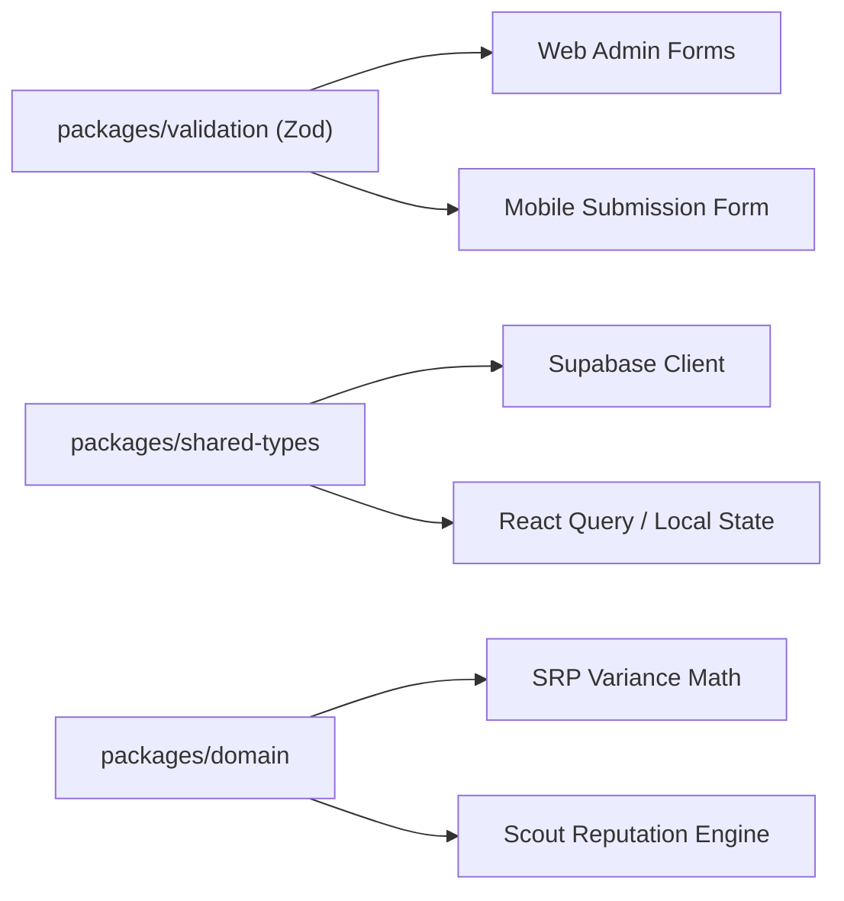

# 📦 API & Data Contracts

The SaanMura ecosystem shares unified TypeScript models and Zod runtime validation across both web and mobile environments.



---

## 📑 Core Data Schemas

### 1. `PriceSubmissionSchema` (`@saanmura/validation`)
```typescript
export const PriceSubmissionSchema = z.object({
  commodityId: z.string().uuid(),
  storeId: z.string().uuid(),
  observedPrice: z.number().positive(),
  observationDate: z.string().datetime(),
  evidencePhotoUrl: z.string().url().optional(),
  evidenceFileBase64: z.string().optional(),
  remarks: z.string().max(300).optional(),
});
```

### 2. `StoreCreationSchema` (`@saanmura/validation`)
```typescript
export const StoreCreationSchema = z.object({
  name: z.string().min(2),
  branchName: z.string().min(2),
  storeType: z.enum(['supermarket', 'hypermarket', 'wet_market', 'convenience_store', 'sari_sari']),
  latitude: z.number().min(-90).max(90),
  longitude: z.number().min(-180).max(180),
  imageUrl: z.string().optional(),
});
```

### 3. SRP Variance Calculations (`@saanmura/domain`)
```typescript
export function calculateSrpVariance(observedPrice: number, srpBaseline: number): {
  diff: number;
  percentage: number;
  status: 'BELOW_SRP' | 'AT_SRP' | 'ABOVE_SRP';
} {
  const diff = observedPrice - srpBaseline;
  const percentage = (diff / srpBaseline) * 100;
  return {
    diff,
    percentage,
    status: diff < 0 ? 'BELOW_SRP' : diff === 0 ? 'AT_SRP' : 'ABOVE_SRP',
  };
}
```

---

## 🔗 Related Notes
- Monorepo Packages: [[Architecture & Monorepo Structure]]
- Database Mirror: [[Supabase & Database Schema]]
- Governance Rules: [[DTI SRP & Civic Quorum Protocol]]
- System Core: [[00 - SaanMura Overview & System Map]]
