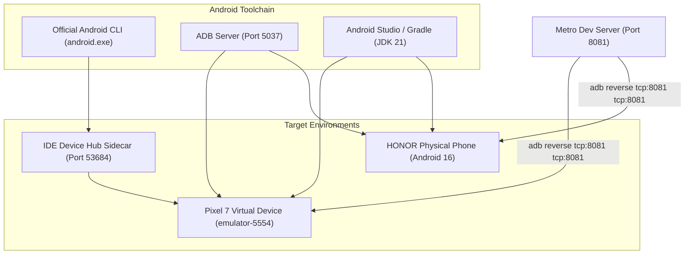

# 🤖 Android Native & Emulation Guide

Comprehensive reference for running, debugging, and mirroring the SaanMura mobile app on physical hardware, virtual devices, and inside Android Studio.



---

## 📱 Hardware & Emulation Status

### 1. Pixel 7 Emulator (`emulator-5554`)
- **OS**: Android 17 ("CinnamonBun")
- **Status**: Online & fully operational.
- **Client**: Expo Go (SDK 52 compatible runtime).
- **Execution**: Runs all camera barcode scans, price lookups, and profile flows cleanly.

### 2. Physical Device (`HONOR BRP-NX1`)
- **OS**: Android 16 (API 36)
- **Status**: Authorized via USB Debugging.
- **Port Reversal**: Configured via `adb reverse tcp:8081 tcp:8081`.
- **Architecture Note**: Android 16 introduces 16KB memory page enforcement. Upgrading to Expo SDK 58 or deploying native debug APKs ensures compatibility with Android 16 Bionic libc.

### 3. Android Studio Integration
- **Project Location**: `D:\Projects_Vibe\SaanMura\apps\mobile\android`
- **Configuration**: Native Gradle project generated via `npx expo prebuild --platform android`.
- **Runtime**: JDK 21 (`21.0.11`) configured with Gradle 8.10.2.
- **Tool Window**: Screen mirroring enabled through the **Running Devices** tab.

---

## 🛠️ Essential Terminal Commands

```powershell
# Check connected devices
adb devices

# Reverse Metro bundler port to any connected device
adb reverse tcp:8081 tcp:8081

# Launch SaanMura directly in Expo Go
adb shell am start -a android.intent.action.VIEW -d "exp://localhost:8081" -n host.exp.exponent/.LauncherActivity

# Take and pull screen capture
adb shell screencap -p /sdcard/screen.png
adb pull /sdcard/screen.png "$env:TEMP\screen.png"
```

---

## 🔗 Related Notes
- Mobile App Specs: [[Mobile App]]
- Architecture: [[Architecture & Monorepo Structure]]
- System Core: [[00 - SaanMura Overview & System Map]]
