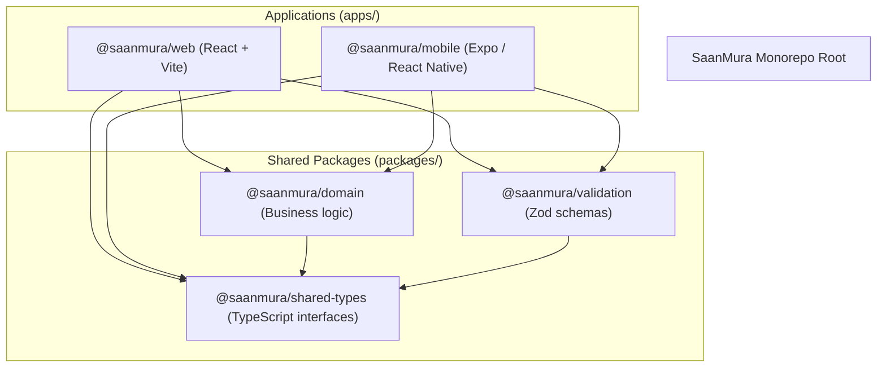

# 🏗️ Architecture & Monorepo Structure

The SaanMura platform is organized as a high-performance **PNPM Workspace** monorepo, decoupling client surfaces from shared domain rules and data validation contracts.

---

## 📁 Repository Layout

| Directory / Package | Description | Tech Stack |
| :--- | :--- | :--- |
| `apps/web` | Web Admin & Civic Acceptance Gatekeeper | React 18, Vite, Tailwind CSS, Lucide |
| `apps/mobile` | Cross-platform Scout Mobile App | Expo SDK 52, React Native 0.76, Expo Router v4 |
| `packages/domain` | Price delta math, SRP variance, quorum rules | TypeScript, Vitest |
| `packages/validation`| Form & API payload validation | Zod 3.x |
| `packages/shared-types`| Database row types, DTOs, Enums | TypeScript |
| `supabase/` | Database migrations, seeds, and schema definitions | Supabase CLI, PostgreSQL 15 |

---

## 🔗 Related Notes
- Connects to: [[00 - SaanMura Overview & System Map]]
- Powered by: [[API & Data Contracts]]
- Client Applications: [[Web Admin Dashboard]], [[Mobile App]]
- Backend: [[Supabase & Database Schema]]
