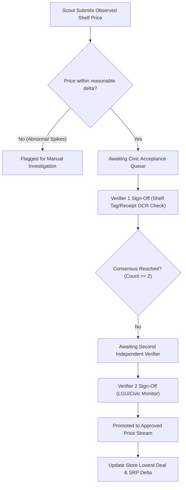

# ⚖️ DTI SRP & Civic Quorum Protocol

To protect the platform against false price logging, merchant manipulation, or erroneous OCR data, SaanMura implements the **Dual-Verifier Quorum Consensus Protocol (v2.4)**.

---

## 📐 Governance Parameters

| Parameter | Current Value | Purpose |
| :--- | :--- | :--- |
| **Quorum Threshold** | $\ge 2$ signatures | Prevents single-actor bias in crowdsourced data |
| **PhilSys Trust Weight** | 1.5x multiplier | Accords higher weight to verified civic scouts |
| **DTI SRP Baseline** | Official e-Presyo Data | Reference benchmark for calculating overpricing alerts |
| **Outlier Threshold** | $> 35\%$ from SRP | Automatically triggers mandatory photo proof requirement |

---

## 🔗 Related Notes
- Implemented In: [[Web Admin Dashboard]]
- Mobile Contributor Flow: [[Mobile App]]
- Audit Log Storage: [[Supabase & Database Schema]]
- System Core: [[00 - SaanMura Overview & System Map]]
