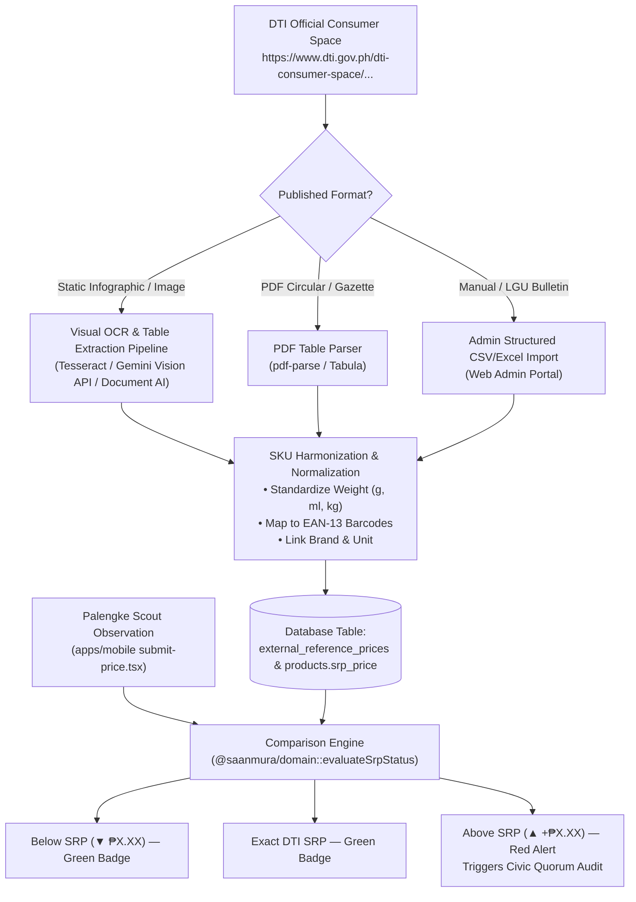

# 📊 DTI SRP Data Ingestion & Comparison Engine

> Comprehensive specification of how SaanMura captures, normalizes, and compares retail grocery prices against the official **Department of Trade and Industry (DTI)** baselines in the absence of an open public REST API.

---

## ⚠️ Real-World DTI Data Access Constraint

The Department of Trade and Industry does **not** provide an open developer API (REST/GraphQL/JSON) for price baselines. 

### Current Official Source:
- **Official URL**: `https://www.dti.gov.ph/dti-consumer-space/dti-latest-srps-basic-necessities-prime-commodities`
- **Legacy URL status**: `dti.gov.ph/konsyumer/latest-srp-bulletin` is deprecated / HTTP 404.
- **Data Format**: Static JPEG/PNG infographics and raster bulletin images (e.g., *DTI SRP Infographic as of May 2026* / PDF circulars), listing price ceilings for **Basic Necessities and Prime Commodities (BNPCs)** under Republic Act No. 7581 (Price Act).



---

## 🛠️ Ingestion & Harmonization Pipeline

To convert raster images and PDF tables into structured database records:

### 1. Vision & Document OCR Pipeline
- When DTI releases an updated SRP bulletin image on the Consumer Space page, the system runs an automated extraction job using:
  - **Document OCR Engine**: Parses rows into commodity name, brand, packaging size, and prescribed ceiling price (₱).
  - **Fuzzy SKU Harmonizer**: DTI names (e.g., *"Mega Sardines in Tomato Sauce 155g"*) are matched against registered database products and mapped to universal barcodes (e.g., `4800049720015`).

### 2. Admin & Civic Verifier Bulk Import
- Administrators and accredited LGU price monitors can directly upload structured CSV/Excel sheets extracted from new DTI releases through the **Web Admin Dashboard**.
- Fields ingested into `external_reference_prices`:
  - `source_id`: Reference to `DTI_E_PRESYO` or `GOV_GAZETTE`.
  - `product_name`, `brand`, `specification`, `unit`.
  - `srp_min_price`, `srp_max_price`.
  - `effective_date`: Date bulletin took effect.

---

## 🧮 Mathematical Comparison Engine

Implemented in [`packages/domain/src/index.ts`](file:///d:/Projects_Vibe/SaanMura/packages/domain/src/index.ts):

### Formulas:
$$\Delta_{\text{SRP}} = P_{\text{observed}} - P_{\text{SRP}}$$

$$\text{Variance (\%)} = \left(\frac{P_{\text{observed}} - P_{\text{SRP}}}{P_{\text{SRP}}}\right) \times 100$$

### Decision Matrix:

```typescript
if (diff < -0.05) {
  // Below SRP: Consumer Bargain Deal
  status = 'below_srp';
  badge = `▼ ₱${Math.abs(diff).toFixed(2)} BELOW SRP`;
} else if (diff > 0.05) {
  // Above SRP: Potential RA 7581 Price Gouging
  status = 'above_srp';
  badge = `▲ +₱${Math.abs(diff).toFixed(2)} (+${Math.abs(percent)}%) ABOVE SRP`;
} else {
  // Exact SRP Compliance
  status = 'at_srp';
  badge = 'EXACT DTI SRP';
}
```

---

## ⚖️ Civic Quorum & Anti-Gouging Enforcement

1. **Automatic Evidence Requirement**: Any observation exceeding SRP ($> +₱0.05$) requires mandatory photographic proof (shelf barcode or POS receipt) uploaded with full resolution.
2. **Dual-Verifier Consensus**: Above-SRP submissions remain in `pending` audit until corroborated by $\ge 2$ independent community monitors or an accredited DTI/LGU market inspector.
3. **Audit Trail**: Verified overpricing incidents are logged on the **Civic Acceptance Gatekeeper** in the Web Admin Dashboard to support consumer welfare mediation and LGU Fair Trade enforcement.

---

## 🔗 Related Notes
- Consensus Protocol: [[DTI SRP & Civic Quorum Protocol]]
- Architecture: [[Architecture & Monorepo Structure]]
- Mobile Scouting: [[Mobile App]]
- Central Map: [[00 - SaanMura Overview & System Map]]
