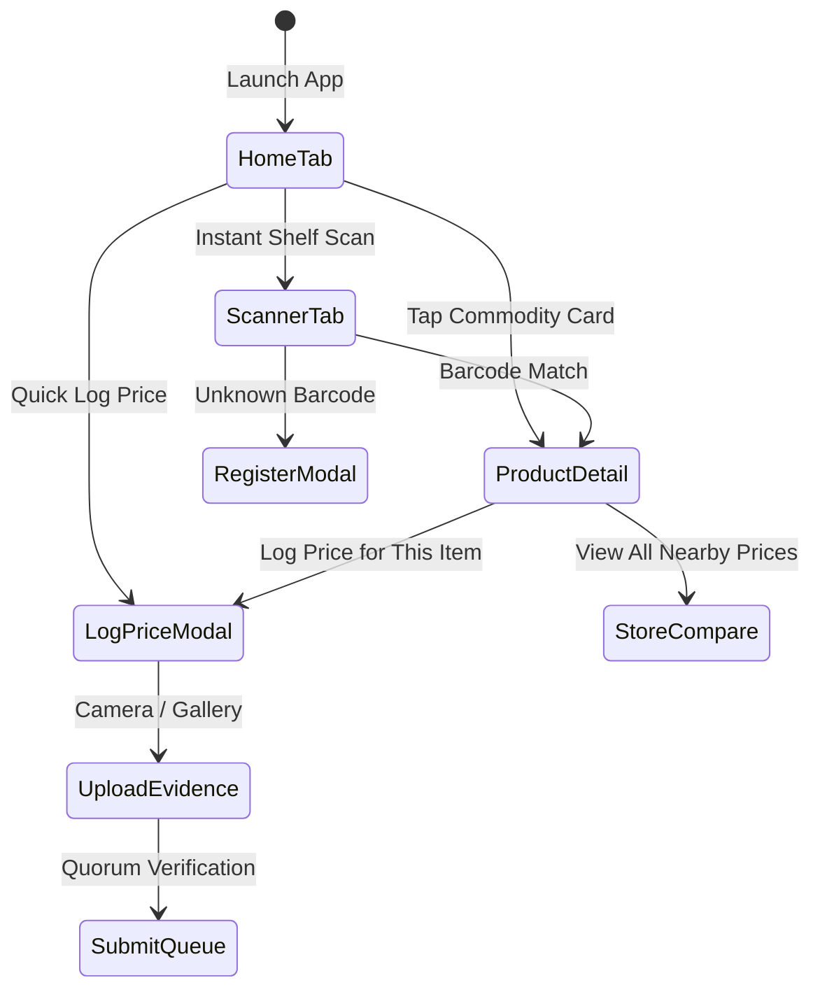

# 📱 SaanMura Mobile App (`@saanmura/mobile`)

The mobile client is built specifically for **Palengke Scouts** and everyday shoppers walking through wet markets, grocery aisles, and convenience stores.

---

## 🧭 Navigation Structure (Expo Router v4)

- `app/_layout.tsx`: Root stack provider with safe area boundaries and custom transition animations.
- `app/(tabs)/index.tsx`: **Home Feed** with Instant Shelf Scan trigger, category quick filters, and live crowdsourced community price stream.
- `app/(tabs)/scanner.tsx`: Full-screen barcode scanner powered by `expo-camera`, supporting EAN-13, UPC-A, and Code 128.
- `app/(tabs)/activity.tsx`: Contribution history showing pending civic verifications, approved logs, and trust points earned.
- `app/(tabs)/profile.tsx`: Scout identity card, PhilSys verification badge, reputation tier, and offline sync storage status.
- `app/product/[id].tsx`: Comprehensive price comparison sheet showing lowest deal, DTI SRP benchmark, and retailer list.
- `app/submit-price.tsx`: Contextual price reporting modal locking the active SKU and enabling direct receipt photo capture.

---

## 🛠️ Native Device Integrations
1. **Camera API (`expo-camera`)**: Fast barcode detection and shelf tag photo auditing.
2. **Geolocation (`expo-location`)**: Automatic proximity detection of the nearest registered palengke or supermarket.
3. **Secure Storage (`expo-secure-store`)**: Encrypted credential storage for authenticated Scout sessions.

---

## 🔗 Related Notes
- Overview: [[00 - SaanMura Overview & System Map]]
- Native Setup: [[Android Native & Emulation Guide]]
- Field Validation: [[DTI SRP & Civic Quorum Protocol]]
- Visual Refinements: [[UX & UI Changelog]]
