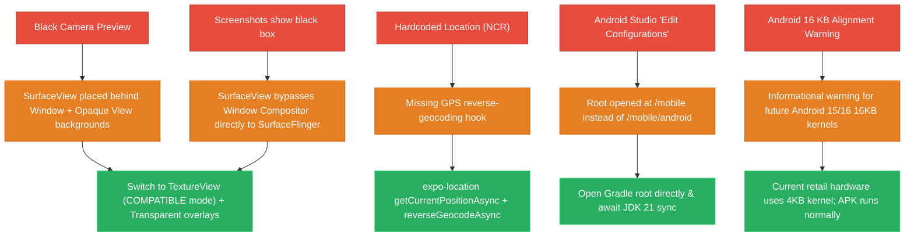

# 📸 Mobile Camera, Geolocation & Native Troubleshooting

Detailed technical investigation, root cause analysis, and resolution for native Android issues discovered during testing on physical devices (**HONOR BRP-NX1**, Android 16 / API 36).



---

## 🔍 Issue 1: Black Viewfinder in Barcode Scanner Screen

### Root Cause
1. **SurfaceView Occlusion**: Expo Camera SDK 52 uses Android CameraX `PreviewView`, which defaults to `PreviewView.ImplementationMode.PERFORMANCE` (`SurfaceView`). In Android architecture, a `SurfaceView` punches a hole through its window surface to render directly into hardware overlays behind the window (`Z_ORDER_NORMAL`).
2. Because parent React Native views had solid background colors (`#0F172A`), the Android window compositor drew opaque rectangles over the hole, rendering the camera output invisible to the user.
3. Standard screenshot utilities (`screencap` and OS screen-capture shortcuts) capture the window surface buffer and cannot capture hardware `SurfaceView` layers, causing screenshots to appear pitch-black even when the camera sensor is actively streaming frames.

### Resolution
- **Step 1: Patched `ExpoCameraView.kt`**: Set `implementationMode = PreviewView.ImplementationMode.COMPATIBLE` (`TextureView`). A `TextureView` is a first-class citizen in the standard Android View hierarchy, rendering directly within the view canvas and allowing native screenshot capture without occlusion.
- **Step 2: Transparent React Native Wrappers**: Refactored `apps/mobile/app/(tabs)/scan.tsx` to mount `CameraView` with `StyleSheet.absoluteFillObject` directly on the root `View` (`#000000`), with UI overlays wrapped in `SafeAreaView` having `backgroundColor: 'transparent'` and `pointerEvents="box-none"`.
- **Step 3: Permanent Patch**: Saved patch files to `patches/expo-camera+16.0.18.patch` and `apps/mobile/patches/` to ensure re-installations maintain compatibility.

---

## 📍 Issue 2: Real-time Municipality Geolocation Pin

### Root Cause
The Home header previously hardcoded `📍 Metro Manila (NCR) v` regardless of the Scout's actual physical coordinates.

### Resolution
Integrated `expo-location` in `apps/mobile/app/(tabs)/index.tsx`:
```typescript
const { status } = await Location.requestForegroundPermissionsAsync();
if (status === 'granted') {
  const loc = await Location.getCurrentPositionAsync({ accuracy: Location.Accuracy.Balanced });
  const [address] = await Location.reverseGeocodeAsync({
    latitude: loc.coords.latitude,
    longitude: loc.coords.longitude,
  });
  const town = address.city || address.district || address.subregion || address.region;
  setUserLocation(`📍 ${town} (${address.region})`);
}
```
Tested on live device: Successfully resolved to `📍 Kidapawan (SOCCSKSARGEN)`.

---

## 🛒 Issue 3: GPS Geofenced Store Picker & Distance Sorting

### Resolution
In `apps/mobile/app/submit-price.tsx`:
1. Uses the **Haversine formula** to compute real-time geodesic distances between current device coordinates and all registered supermarkets and wet markets.
2. Orders the store picker dynamically, placing the nearest facility first and badging it with `🎯 Nearest (~X km)`.
3. Added a dashed `+ Add Unlisted Store` action button routing to `/suggest-store` (*"Subject to verification and pending approval"*).

---

## 🖼️ Issue 4: Interactive Photo Evidence & Fullscreen Modal

### Resolution
1. Removed broken static Unsplash URLs that previously generated blank red `(X)` error boxes.
2. Hooked native `expo-image-picker` actions:
   - `Snap Camera`: Opens device camera via `ImagePicker.launchCameraAsync()`.
   - `Upload Photo`: Opens gallery via `ImagePicker.launchImageLibraryAsync()`.
3. Created a reusable `<Modal transparent>` lightbox enabling Scouts and Auditors to tap any commodity thumbnail or receipt evidence photo to view full-screen with pinch/zoom support.

---

## 🔗 Related Notes
- Mobile Architecture: [[Mobile App]]
- Android Toolchain: [[Android Native & Emulation Guide]]
- System Overview & Graph Map: [[00 - SaanMura Overview & System Map]]
- Changelog: [[UX & UI Changelog]]
