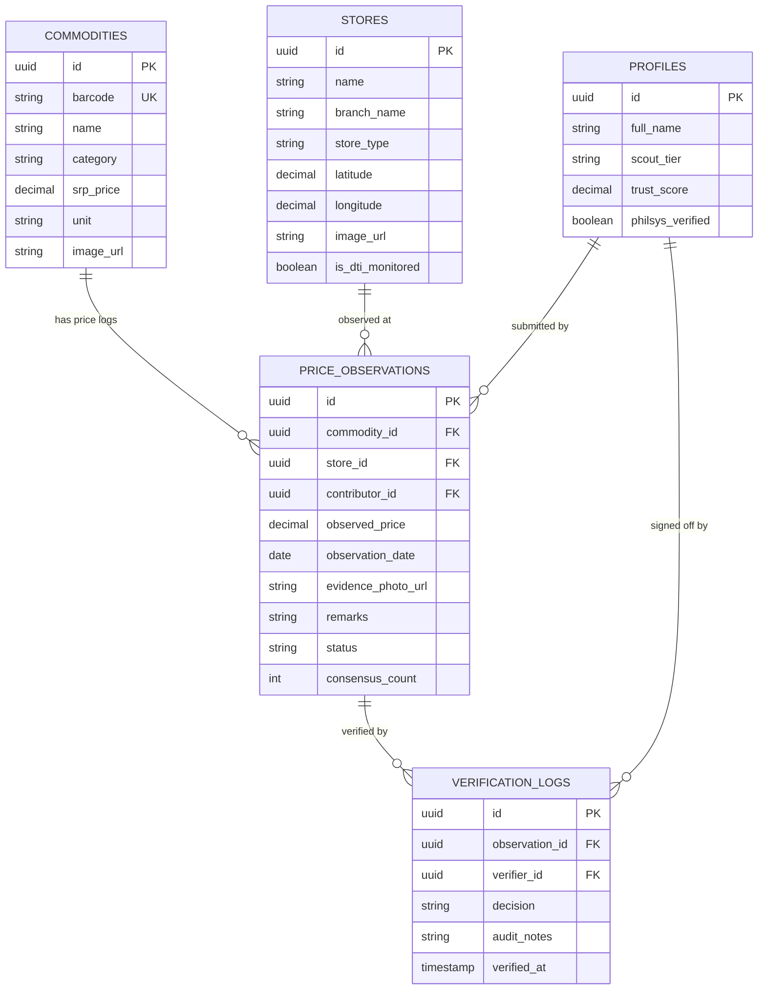

# 🗄️ Supabase & Database Schema

The persistence layer runs on **Supabase PostgreSQL 15**, utilizing Row Level Security (RLS) to enforce civic integrity and verifiable price logs.

---

## 🔒 Security & Verification Policies

- **Public Reads**: Monitored commodity prices and DTI baselines are publicly queryable without authentication.
- **Scout Submissions**: Authenticated scouts can insert price observations into the `pending_verification` state.
- **Quorum Transition**: Observations are only promoted to `approved` and exposed to the public price stream once $\ge 2$ independent verifiers record positive consensus.

---

## 🔗 Related Notes
- Architecture: [[Architecture & Monorepo Structure]]
- Verification Engine: [[DTI SRP & Civic Quorum Protocol]]
- Type Mappings: [[API & Data Contracts]]
