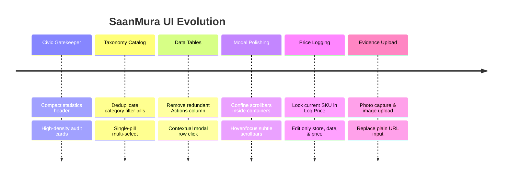

# ✨ UX & UI Changelog

A comprehensive audit of recent user experience improvements, visual enhancements, and ergonomics optimizations across SaanMura.

---

## 📋 Detailed Changes & Rationales

### 1. Compact Civic Acceptance Gatekeeper
- **Issue**: The Gatekeeper header was visually crowded with large stat widgets taking up prime vertical screen space.
- **Solution**: Refactored the overview tiles into clean, compact badges with inline trend indicators and stable consensus metrics.

### 2. Deduplicated Commodity Category Pills
- **Issue**: Category filters rendered duplicate tags (e.g., two "Canned Goods", two "Condiments").
- **Solution**: Implemented dynamic distinct category aggregation (`Array.from(new Set(...))`) with clean counts and singular active state toggles.

### 3. Removal of Redundant "ACTIONS" Table Column
- **Issue**: The table had a repetitive column with duplicate buttons ("+ Log Price", "Price Trends") cluttering row space.
- **Solution**: Removed the Actions column. Clicking any row directly opens the **Price Trends modal**, which features an integrated, prominent **"+ Log New Store Price"** action button.

### 4. Focused "Log New Price" Modal
- **Issue**: Clicking "Log New Store Price" previously opened a full product registration form.
- **Solution**: The modal now locks the active commodity (name, SKU, unit, photo) in a read-only header card, only asking the scout to provide:
  - Purchased At Store / Retailer
  - Observed Shelf Price (₱) with auto-calculated SRP delta
  - Observation Date
  - Evidence Photo (Shelf Tag or POS Receipt)
  - Contributor Remarks

### 5. Native Image Capture & File Upload for Evidence & Stores
- **Issue**: Forms previously expected scouts and admins to paste an image URL (`https://...`).
- **Solution**: Built an interactive file upload and camera capture component with image preview, remove button, and quick preset buttons. Applied to both **Log New Price** and **Add New Store** modals.

### 6. Subtle, Container-Contained Scrollbars
- **Issue**: System scrollbars leaked outside modal boundaries and looked heavy.
- **Solution**: Styled custom Webkit scrollbars (`scrollbar-thin`, muted track, subtle thumb) that sit strictly inside the modal container and only become visible when hovered or focused.

### 7. Mobile Dynamic GPS Geolocation Pin
- **Issue**: Header location pin was statically hardcoded to "Metro Manila (NCR)" regardless of device location.
- **Solution**: Integrated `expo-location` reverse geocoding to dynamically resolve device coordinates to the current municipality/city and region (e.g., `📍 Kidapawan (SOCCSKSARGEN)`).

### 8. Mobile Redundant Barcode Scanner Removal
- **Issue**: The home screen header displayed a barcode icon next to the notification bell in addition to the prominent instant scanner banner and floating bottom tab scanner.
- **Solution**: Removed the redundant header icon, reserving `headerRight` exclusively for unread civic notifications.

### 9. Instant Search Clear ("X") Button
- **Issue**: Scouts had to manually backspace or select all text to clear search queries.
- **Solution**: Added an inline circular `(X)` dismiss button inside the search input that dynamically renders when `searchQuery.length > 0` and instantly resets the query.

### 10. GPS Geofenced Nearest Store Prioritization & Unlisted Store Submission
- **Issue**: Store selection in Price Observation was alphabetical and did not reflect proximity to the scout's actual location.
- **Solution**: Computed Haversine geographical distances between the scout's GPS position and registered supermarkets/markets. The nearest store is badged (`🎯 Nearest (~X km)`) and pre-selected. Added a dashed `+ Add Unlisted Store` chip routing to `/suggest-store` ("Subject to verification and pending approval").

### 11. Fullscreen Clickable Image Lightbox
- **Issue**: Product thumbnails were small with fixed dimensions and could not be inspected in detail.
- **Solution**: Made commodity pictures and evidence photos tap-to-expand into a fullscreen semi-transparent lightbox modal with zoom badge and safe-area close target.

### 12. Camera Viewfinder TextureView Compatible Mode
- **Issue**: `expo-camera` rendered a black screen on physical Android devices due to `SurfaceView` hardware layer occlusion beneath opaque parent views and compositor bypass during screenshots.
- **Solution**: Swapped CameraX `PreviewView` to `ImplementationMode.COMPATIBLE` (`TextureView`), made camera overlay containers transparent with `pointerEvents="box-none"`, enabling 60 FPS live camera footage directly visible on device and capturable in screenshots.

---

## 🔗 Related Notes
- Web Implementation: [[Web Admin Dashboard]]
- Mobile Implementation: [[Mobile App]]
- Central Map: [[00 - SaanMura Overview & System Map]]
