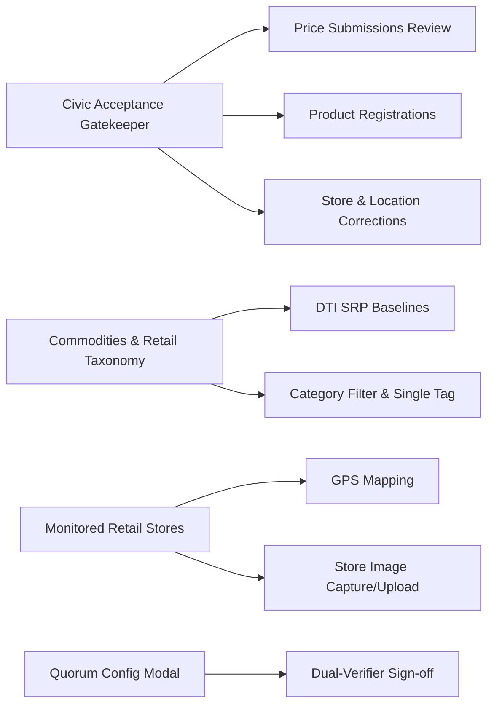

# 💻 Web Admin Dashboard (`@saanmura/web`)

The Web Dashboard serves as the central command post for **LGU Verification Officers**, **DTI Market Auditors**, and community supervisors.

---

## 🔑 Core Functional Modules

### 1. Civic Acceptance Gatekeeper
- Review crowdsourced submissions against DTI Suggested Retail Price (SRP) baselines.
- Real-time audit trail displaying OCR-scanned receipts and shelf tag photos.
- One-click **Approve**, **Reject**, or **Flag for Dual Verification**.

### 2. Commodities & Retail Taxonomy Catalog
- Displays monitored SKUs, current lowest price, and DTI baseline status.
- Interactive **Price Trends modal** with multi-store comparison charts (Puregold, SM Supermarket, Robinsons).
- In-modal **"+ Log New Store Price"** button directly bound to the active product.

### 3. Monitored Stores Directory
- Directory of wet markets (*palengke*), supermarkets, and mini-marts across NCR and regions.
- Store metadata includes physical coordinates, registered branch name, and verification tier.

---

## 🎨 Recent Architectural Upgrades
- **Compact Header**: Streamlined Gatekeeper overview statistics for higher information density.
- **Deduplicated Category Pills**: Fixed duplicated taxonomy pills by introducing singular dynamic grouping.
- **Embedded Modal Scrollbars**: Customized scrollbars to remain inside the modal card boundaries, fading in subtly only during container focus or hover.
- **Store Photo Capture**: Implemented dual-mode image picker (device camera or file upload) in the "Add New Store" dialog.

---

## 🔗 Related Notes
- Overview: [[00 - SaanMura Overview & System Map]]
- Protocol Enforcement: [[DTI SRP & Civic Quorum Protocol]]
- Visual Refinements: [[UX & UI Changelog]]
- Underlying Models: [[Supabase & Database Schema]]
